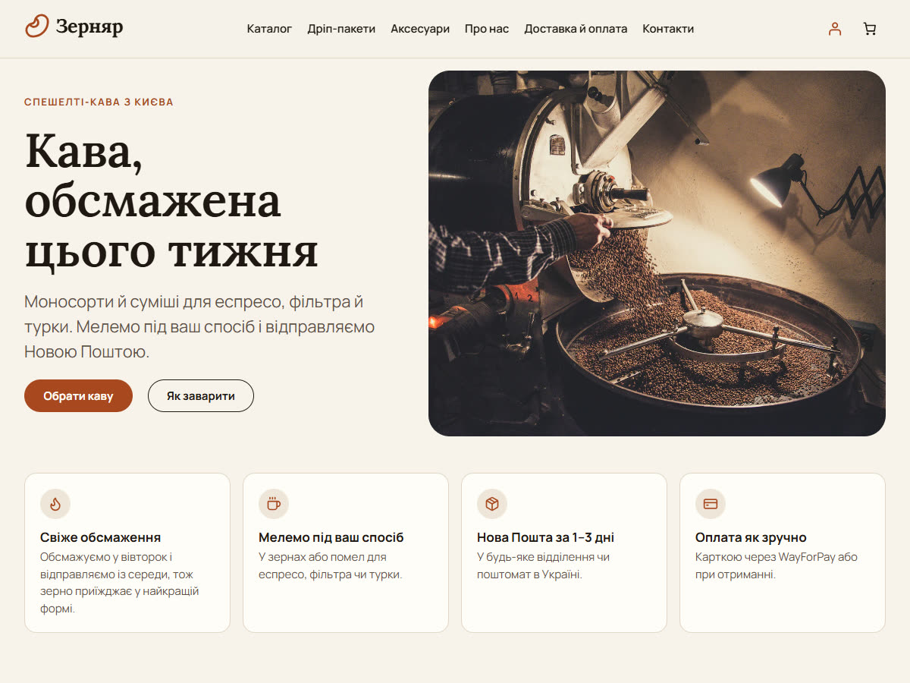

# Zernyar

A demo WooCommerce store for a coffee roastery in Ukraine, built as a portfolio project. The store is fictional: payments run in test mode and nothing is shipped.



The work lives in three parts:

| Part | What it is |
| --- | --- |
| [`plugins/ua-commerce-kit`](plugins/ua-commerce-kit) | A WooCommerce plugin with Nova Poshta delivery, WayForPay payments and Telegram order notifications. Nothing in it is specific to this store. |
| [`themes/zernyar`](themes/zernyar) | The block theme: home page, catalog with filters, product page, cart and checkout, in Ukrainian. |
| [`plugins/zernyar-demo`](plugins/zernyar-demo) | The demo catalog (19 products, 12 of them coffees with weight and grind variations), pages and menu, and settings for free hosting. |

## Run it locally

You need Docker, Node 20+ and Bash (Git Bash on Windows).

```bash
npm ci
npm run build
bash scripts/setup.sh
```

The script creates `.env` with random local passwords, starts WordPress 7.1 on PHP 8.3 with MariaDB 10.4, installs WooCommerce, activates the theme and the plugins and imports the demo catalog. The store opens at http://localhost:8090; the admin user and password are in `.env`.

## Documentation

- [Development](docs/development.md): containers, checks, Telegram on the local site
- [Theme](docs/theme.md): design tokens, templates, translations
- [Demo content](docs/demo-content.md): the import and the generated product images
- [Nova Poshta](docs/nova-poshta.md): shipping method, checkout picker, server checks

## License

GPL-2.0-or-later, like WordPress and WooCommerce. Fonts, icons and photos keep their own licenses, listed in the theme's and the demo plugin's `readme.txt`.
